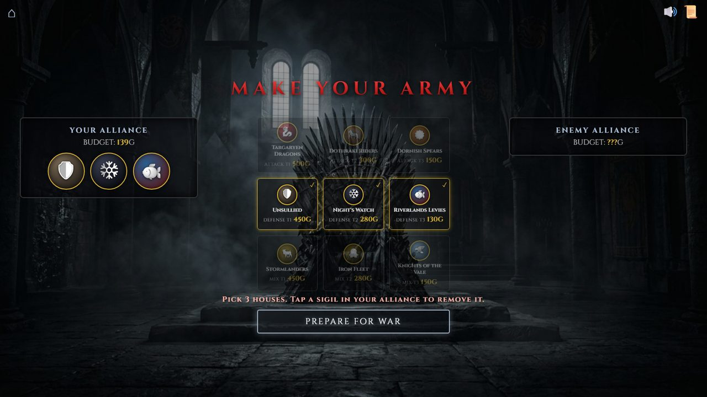
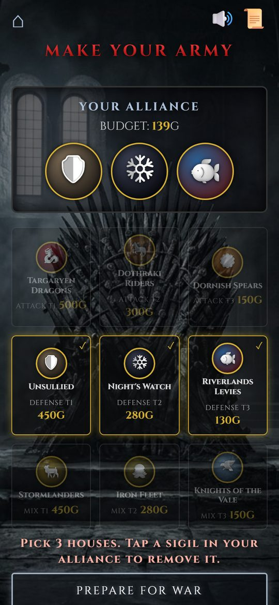

<div align="center">

# ⚔️ Battle for Westeros

**Draft three houses, out-think the enemy alliance, win the war.**<br>
A strategy game for the browser, built with nothing but HTML, CSS and JavaScript.

[](https://redrighthand2007.github.io/GOT/)

[](https://github.com/redrighthand2007/GOT/actions/workflows/tests.yml)


[](./LICENSE)

<br>


</div>

## 🎮 How it plays

1. **Draft:** pick **3 of 9 houses** with a budget of **999 gold**. Each house has a type, a tier and a price.
2. **Counter:** types work like rock-paper-scissors. **Attack** beats **Mix**, **Mix** beats **Defense**, **Defense** beats **Attack**. Each of the 9 house-vs-house matchups is worth ±5% strength.
3. **Prepare for war:** the enemy reveals its alliance, and you see both sides' type edge.
4. **Fight:** strength = power × (1 + type edge) × luck (0.85–1.15). The stronger army wins.

On **Normal** the enemy picks a random alliance. On **Hard** it picks the one that counters yours, so a balanced army is your best defence. Wins, losses and your best streak are saved on your device.

<div align="center">
  
  
</div>

## 📱 One game, every screen

The same page adapts to phones, tablets and PCs. Three columns on wide screens, one scrolling column on narrow ones, with an animated switch between them.

<div align="center">
  
  &nbsp;&nbsp;
  
</div>

## 🛠️ Technical highlights

| Area | What's done |
|---|---|
| **No dependencies** | Plain HTML, CSS and JavaScript. No frameworks, libraries or build step. Open `index.html` and it runs. |
| **Game logic** | Rules, prices, the type triangle, battle maths and the enemy AI live in [`js/rules.js`](js/rules.js), kept separate from the page code so they can be tested on their own. |
| **Tests & CI** | 17 rule and balance tests in [`tests/`](tests/) run in any browser, and in headless Chrome on every push via GitHub Actions. They caught a real balance bug: a 980G army that beat every enemy. |
| **Responsive layout** | Sizes in `rem` and `clamp()`, so browser zoom scales smoothly. CSS Grid layout switch animated with the View Transitions API, with a hand-written fallback for browsers without it. Safe-area insets for phone notches. |
| **Audio** | Web Audio API routing for smooth fades, the music dip during fights, and pausing in background tabs (which also makes volume work on iPhone). Victory and defeat war horns are synthesised in code, with no audio files. |
| **Accessibility** | Every control is a real `<button>` with a label, keyboard focus is visible, screen readers hear results announced, and animations respect *reduce motion*. |
| **Performance** | House crests are drawn in CSS instead of images, the background image went from 702 KB to 114 KB, scripts load with `defer`, and the music only downloads once you join the war. The page fades in only once its font has loaded, so nothing jumps. |

### Lighthouse scores (PageSpeed Insights, November 2026)

| | Performance | Accessibility | Best Practices | SEO |
|---|:---:|:---:|:---:|:---:|
| 🖥️ Desktop | **100** | **100** | **100** | **100** |
| 📱 Mobile (slow 4G) | **98** | **100** | **100** | **100** |

## 📁 Project structure

```text
├── index.html            # the whole game is one page
├── css/got-theme.css     # styles, layouts and animations
├── js/
│   ├── rules.js          # houses, type triangle, battle maths, enemy AI
│   ├── data.js           # page elements, game state, saved stats, zoom/layout motion
│   ├── audio.js          # music, sound effects, mute
│   ├── ui.js             # screens, drafting board, rules panel
│   └── combat.js         # drafting, battle flow, results
├── tests/                # open tests/index.html to run the rule tests
├── assets/               # background image, music, sword sound
└── docs/screenshots/     # images used in this README
```

## ▶️ Run it locally

```bash
git clone https://github.com/redrighthand2007/GOT.git
cd GOT
python -m http.server 5173
```

Then open `http://localhost:5173`. Double-clicking `index.html` also works; serving the folder just enables the smoothest audio.

To change houses, prices or rules, edit [`js/rules.js`](js/rules.js), then open `tests/index.html` to check the game is still balanced.

## 🗺️ Roadmap

- [x] Budget drafting, type triangle, Normal and Hard enemy AI
- [x] Win streaks saved on the device
- [x] Phone, tablet and PC layouts with smooth zoom
- [x] Automated rule and balance tests

## 📄 License & credits

The source code is released under the [MIT License](./LICENSE).

This is an **unofficial, non-commercial fan project** and is not affiliated with HBO. *Game of Thrones* names and the theme music belong to their owners (HBO / George R. R. Martin) and are not covered by the MIT license.

---

<div align="center">

Made by **Kush Aghera** · [@redrighthand2007](https://github.com/redrighthand2007)

</div>
