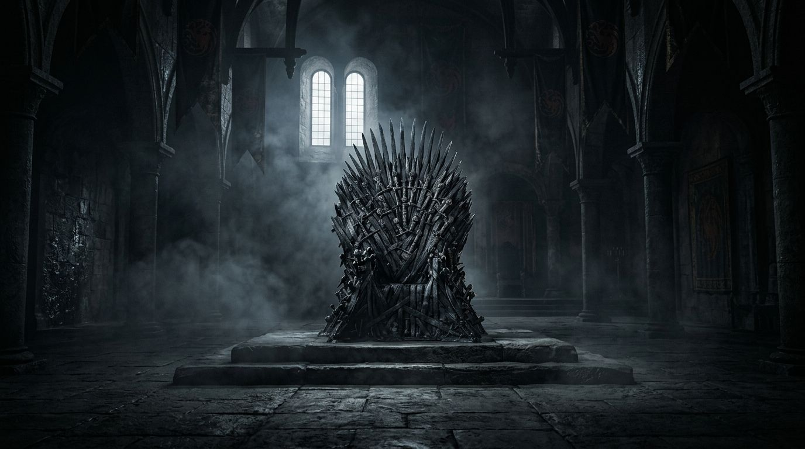

<div align="center">

# ⚔️ Battle for Westeros ⚔️

**A fast strategy game for the browser, built with plain HTML, CSS and JavaScript. No frameworks, no build step.**

[](https://redrighthand2007.github.io/GOT/)
[](./LICENSE)

</div>

## 📸 Preview

<div align="center">
  
</div>

## ✨ Features

- **💰 Draft with a budget:** pick 3 of 9 houses with 999 gold. Every house has a type (Attack, Defense or Mix), a tier and a price.
- **🔺 Type triangle:** Attack beats Mix, Mix beats Defense, Defense beats Attack. Every winning house-vs-house matchup gives +5% strength, every losing one -5%.
- **🤖 Two difficulties:** on *Normal* the enemy picks a random alliance; on *Hard* it picks the alliance that counters yours.
- **🏆 Win streaks:** wins, losses, current and best streak are saved on your device.
- **📱 Works everywhere:** one layout for phones, tablets and PCs; browser zoom scales smoothly; layout changes animate instead of jumping.
- **🎵 Sound:** theme music starts when you join the war, dips during fights, pauses in background tabs; war horns for victory and defeat are generated in the browser. Mute is remembered.
- **♿ Keyboard and screen-reader friendly:** every control is a real button with a label.

## 🛠️ Tech Stack

- HTML5, CSS3, vanilla JavaScript (no dependencies)
- Web Audio API for fades and the generated horn/drum sounds
- Hosted on GitHub Pages

## 📁 Project Structure

```text
GOT/
├── assets/
│   ├── audio/          # theme music and sword sound
│   └── images/         # background art
├── css/
│   └── got-theme.css   # all styles, layout and animations
├── js/
│   ├── data.js         # houses, rules, saved stats, layout/zoom motion
│   ├── audio.js        # music, sound effects, mute
│   ├── ui.js           # screens, drafting board, info panel
│   └── combat.js       # drafting rules, enemy AI, battle maths
├── tools/
│   └── bump-version.mjs  # cache-busting helper (see below)
├── index.html
├── LICENSE
└── README.md
```

## ⚙️ Run it locally

1. Clone the repository:
   ```bash
   git clone https://github.com/redrighthand2007/GOT.git
   ```
2. Open `index.html` in a browser, or serve the folder (recommended, so all sound features work):
   ```bash
   python -m http.server 5173
   ```
   then open `http://localhost:5173`.

## 🚀 How to play

1. Tap **JOIN THE WORLD WAR** (choose *Normal* or *Hard* first).
2. Pick **3 houses** within **999G**. Tap a sigil in your alliance to remove it. The 📜 button shows all rules and prices.
3. **Prepare for war** reveals the enemy alliance and both sides' type edge.
4. **Fight!** Strength = total power × (1 + type edge) × luck (0.85x–1.15x). Higher strength wins.

## 🔧 Changing things

- **Houses, prices, power, rules:** `HOUSES_DATA`, `ENEMY_COMBOS`, `STARTING_GOLD` and `TYPE_EDGE` in `js/data.js`.
- **Music levels or your own victory/defeat clips:** `MUSIC_LEVEL`, `FIGHT_LEVEL` and `STING_FILES` at the top of `js/audio.js`.
- **After changing CSS or JS, before pushing:** run `node tools/bump-version.mjs` so players' browsers load the new files instead of cached old ones.

## 🗺️ Roadmap

- [x] Core game, Iron Throne theme and enemy AI
- [x] Type triangle and difficulty levels
- [x] Win/loss streaks saved on the device
- [x] Phone, tablet and PC layouts with smooth zoom
- [ ] Campaign across Westeros battlefields
- [ ] Animated battle scenes
- [ ] Installable app (PWA) with offline play

## 📄 License

The source code is released under the [MIT License](./LICENSE).

**This is an unofficial fan project and is not affiliated with HBO.** *Game of Thrones* names, artwork and music belong to their respective owners (HBO / George R. R. Martin) and are **not** covered by the MIT license.

## 👨‍💻 Author

**Kush Aghera** · GitHub: [@redrighthand2007](https://github.com/redrighthand2007)
